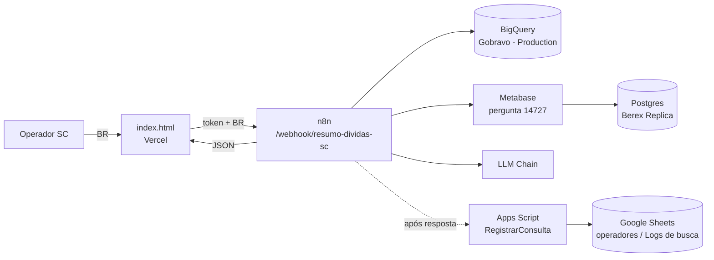

# Copiloto SC — Assistente de Dívida

Ferramenta interna da **Bravo** para o time de **Serviço ao Cliente (SC)** consultar, em segundos, a situação completa das dívidas de um cliente a partir do **BR** (`bank_reference`).

O Copiloto reúne em uma única tela informações que antes ficavam espalhadas entre Berex, Vanex e Postgres: status de cada dívida, valores negociados, desconto real, parcelas pagas, pagamentos estruturados e alertas como acordo quebrado.

🔗 **Produção:** [copiloto-sc.vercel.app](https://copiloto-sc.vercel.app)
👥 **Público:** ~15–20 operadores do time de SC (acesso restrito a e-mails `@gobravo.com.br`)

---

## Sumário

- [Visão geral](#visão-geral)
- [Arquitetura](#arquitetura)
- [Front-end](#front-end)
- [Back-end (n8n)](#back-end-n8n)
- [Autenticação e sessão](#autenticação-e-sessão)
- [Registro de uso (Apps Script)](#registro-de-uso-apps-script)
- [Fontes de dados](#fontes-de-dados)
- [Regras de negócio](#regras-de-negócio)
- [Deploy](#deploy)
- [Troubleshooting e armadilhas conhecidas](#troubleshooting-e-armadilhas-conhecidas)
- [Limitações conhecidas](#limitações-conhecidas)
- [Pendências / roadmap](#pendências--roadmap)

---

## Visão geral

| Item | Detalhe |
|---|---|
| Front-end | Um único `index.html` (HTML + CSS + JS puro, sem framework) |
| Hospedagem | Vercel — deploy automático a cada push na branch principal |
| Back-end | Workflows n8n self-hosted (`ops.flows.gobravo.dev`) |
| Dados | BigQuery (`Gobravo - Production`) + Postgres Berex Replica (via Metabase) |
| IA | Basic LLM Chain no n8n para gerar o resumo em linguagem natural |
| Login / log de uso | Google Sheets + Google Apps Script |

**Fluxo de uso:**

1. Operador entra com e-mail `@gobravo.com.br` e senha (cria a senha no primeiro acesso).
2. Digita o BR do cliente.
3. Recebe o resumo: dados do programa, visão por dívida, desconto, parcelas e alertas.

---

## Arquitetura



---

## Front-end

- Arquivo único: **`index.html`**, com CSS e JS embutidos.
- Duas telas: **login** e **resultado**.
- Token de sessão guardado no `localStorage` (validade de 30 dias).

### Principais componentes da tela de resultado

- **Visão dívida** — cards por status (Em aberto, Paga, Estruturada, Cancelada…). Qualquer status desconhecido aparece automaticamente como card extra, para não sumir silenciosamente.
- **Card de dívida** (`criarCardDivida`) — banco, valores original / plano / atualização, desconto, mês previsto de quitação e badges.
- **Badges**
  - Status da dívida (`.status-divida-badge`)
  - **Acordo quebrado** (`.status-divida-badge.acordo_quebrado`, vermelho `#e5484d`) — exibido ao lado do status, para qualquer status.
  - Classificação qualitativa do desconto (ex.: "abaixo do esperado").
- **Tabela de parcelas do pagamento estruturado** — Nº, Data, Valor, Destino, Status. Aparece só para dívidas "Estruturado em andamento".

---

## Back-end (n8n)

Instância self-hosted: `ops.flows.gobravo.dev`

### Webhooks

| Endpoint | Função |
|---|---|
| `/webhook/resumo-dividas-sc` | Consulta principal (resumo das dívidas) |
| `/webhook/verificar-email` | Valida domínio `@gobravo.com.br` e checa se é primeiro acesso |
| `/webhook/criar-senha` | Primeiro acesso: grava hash + salt da senha |
| `/webhook/login` | Login (e-mail + senha) e geração do token |
| `/webhook/registrar-uso` | Contador de uso por operador (fire-and-forget) |

> ⚠️ **CORS:** todos os webhooks precisam ter `https://copiloto-sc.vercel.app` em **Allowed Origins** (Options do node Webhook). Sem isso o navegador bloqueia a chamada.

### Workflow principal — `/webhook/resumo-dividas-sc`

```
Webhook
 → ValidarSessao → SessaoValida? → validarBR
 → BuscarDividasCliente (BigQuery)   ─┐
 → BuscarDividasPostgres (Metabase)  ─┴→ Merge → AgruparDividas
 → CurvadeDesconto → Basic LLM Chain → Parsear resposta do LLM
 → CombinarDados → Verificar 45 Dias → Respond to Webhook
 → RegistrarConsulta (HTTP → Apps Script)
```

| Node | Responsabilidade |
|---|---|
| `ValidarSessao` | Valida o token HMAC e extrai `operador_email` |
| `validarBR` | Normaliza e valida o BR digitado |
| `BuscarDividasCliente` | Dados do programa, aditivos, plano de liquidação e depósitos (BigQuery) |
| `BuscarDividasPostgres` | Dívidas ao vivo via pergunta Metabase **14727** ("Dívidas copiloto \| SC") |
| `AgruparDividas` | Consolida dívidas, faz parse de `labels` e calcula `acordo_quebrado` |
| `CurvadeDesconto` | Classifica o desconto de cada dívida contra a curva esperada |
| `Basic LLM Chain` | Gera o resumo textual para o operador |
| `CombinarDados` | Monta o JSON final (whitelist de campos) |
| `Verificar 45 Dias` | Regra de alerta temporal |
| `RegistrarConsulta` | Log + contador via Apps Script (depois da resposta, `onError: continueRegularOutput`) |

> 💡 **Atenção ao adicionar campos por dívida:** o `CurvadeDesconto` reconstrói as dívidas e **não repassa** campos extras. Por isso o `CombinarDados` lê as tags direto de `$('AgruparDividas')`, casando cada dívida por `banco|valor_original.toFixed(2)`. Qualquer campo novo precisa do mesmo cuidado (ou ser incluído no `CurvadeDesconto`) e também precisa estar na whitelist do `CombinarDados`.

---

## Autenticação e sessão

- Login com e-mail corporativo (`@gobravo.com.br`) + senha individual.
- **Primeiro acesso:** o operador cria a própria senha; é gravado **hash + salt** na aba `operadores`.
- **Sessão:** token assinado com **HMAC** (chave secreta compartilhada entre `GerarSessao` e `ValidarSessao`), válido por **30 dias**, guardado no `localStorage`.
- **Esqueceu a senha?** Aviso fixo na tela: *"Fale com seu gestor"* (reset manual na planilha).
- Coluna `ativo` na aba `operadores` permite desativar um acesso.

---

## Registro de uso (Apps Script)

Desde **19/10/2026**, log e contador são feitos por um único Apps Script, em vez de vários nodes Google Sheets no n8n.

**Por quê:** a credencial do Sheets é compartilhada com outros fluxos e tem cota de 60 req/min por projeto. Cada consulta gastava ~5 chamadas, e uma falha nesses ramos derrubava a resposta para o operador.

**Como funciona:**

- Node HTTP `RegistrarConsulta`, ligado **depois** do `Respond to Webhook` (não atrasa a resposta).
- Body:

  ```json
  {
    "token": "<token do script>",
    "action": "registrar_consulta",
    "email": "<operador_email>",
    "br": "<bank_reference>"
  }
  ```

- O script (Web App, `doPost`, executar como "Eu", acesso "Qualquer pessoa"):
  - grava uma linha em **Logs de busca** (`operador`, `bank_reference`, `data consulta`, `mes_tag`);
  - incrementa `total_consultas` e atualiza `ultima_consulta_em` em **operadores**, com `LockService` (incremento atômico).
- Resposta: `{ ok, log_linha, operador_encontrado, total_consultas }`.

**Trade-off:** só são registradas consultas que chegam ao `Respond to Webhook`.

### Cuidados com o Apps Script

- **Salvar o código não atualiza a URL `/exec`.** É preciso: *Gerenciar implantações → lápis → Nova versão → Implantar*. Não crie uma implantação nova, senão a URL muda.
- **Não use `appendRow` / `getLastRow`** na aba "Logs de busca": ela tem centenas de milhares de linhas "vazias" com conteúdo invisível. O script encontra a próxima linha descendo do topo da coluna `operador` (`getNextDataCell(DOWN)`).
- Cabeçalhos são casados de forma normalizada (trim, minúsculas, sem acento, `_` = espaço).

---

## Fontes de dados

### BigQuery — projeto `Gobravo - Production`

| Tabela | Uso |
|---|---|
| `berex.credit_repairs` | Programa do cliente (por `bank_reference`) |
| `berex.credit_repair_debts` | Dívidas |
| `berex.addendum` | Aditivos (`new_debts`) |
| `vanex_public.leads_lead` | Ponte `tracker_id` → plano |
| `vanex_public.settlement_plan` | Plano de liquidação original (`debts`) |
| `dealer_public.bank_transactions` | Depósitos do cliente |

### Postgres Berex Replica (via Metabase, `database_id = 12`)

Acessado por HTTP Request no n8n chamando a **pergunta 14727 — "Dívidas copiloto | SC"**.

| Tabela | Uso |
|---|---|
| `berex.credit_repair_debts` | Valores ao vivo, `state`, `settlement_month`, `labels` |
| `berex.structured_payments` | Parcelas do pagamento estruturado |
| `berex.credit_repairs` | Programa |
| `berex.addendum` | Aditivos |

Campos de tags devolvidos pela pergunta:

- `acordo_quebrado` — boolean (`'broken_agreement' = ANY(crd.labels)`)
- `labels` — texto separado por vírgula (`array_to_string`)

> Por que híbrido? O `credit_repair_debts` do BigQuery não tem todos os campos monetários preenchidos; o Postgres tem.

### Google Sheets — planilha de controle de acesso

| Aba | Colunas |
|---|---|
| `operadores` | `email`, `senha_hash`, `salt`, `ativo`, `criado_em`, `total_consultas`, `ultima_consulta_em` |
| `Logs de busca` | `operador`, `bank_reference`, `data consulta`, `mes_tag` |

> O ID da planilha, o token do Apps Script e a chave HMAC **não** ficam neste repositório.

---

## Regras de negócio

### Status das dívidas (`classificarStatus`)

| `state` | Exibição |
|---|---|
| `new`, `negotiation` | Em aberto |
| `paid`, `paid_portfolio_payment`, `liquidada`, `liquidada_por_credito` | Paga (unificado em badge, contagem e filtro) |
| `liquidation_structured_payment` | Estruturado em andamento |
| `cancelled` | Cancelada |
| qualquer outro | Card extra automático na "Visão dívida" |

### Tags da dívida — "Acordo quebrado"

- Origem: `berex.credit_repair_debts.labels` (`varchar[]`; uma dívida pode ter várias tags).
- `broken_agreement` → badge **Acordo quebrado** (o mesmo que o CRM mostra).
- Outras tags existentes: `agreement_reached`, `amount_corrected`, `client_contacted`, `counter_proposal`, `pending_agreement`, `proposal_sent`, `refinancing`, `sent_to_pay`, `sued`, `waiting_for_deposit`, `withdrawal`, entre outras.

### Mês previsto de quitação — cadeia de fallback

Do mais confiável para o mais reserva:

1. **Ao vivo:** `settlement_month` do Postgres (só preenchido quando `state = 'new'`).
2. **Snapshot do aditivo:** `berex.addendum.new_debts`, casado por banco + valor. Busca em **todos** os aditivos aprovados, do mais novo para o mais antigo.
3. **Snapshot do plano original:** `vanex_public.settlement_plan.debts`, casado por `uid`.

### Pago total plano (valor negociado inicialmente)

1. `payment_to_bank + reduction_commission` do `settlement_plan.debts` (bate exato com o Berex).
2. Sem snapshot: estimativa `valor_pago_banco_inicial + max(0, economia × 17,5%)`.

### Pago total atualização (valor atual, com comissão)

```
comissão        = max(0, (amount − payment_to_bank) × 17,5%)
pago_total_atual = payment_to_bank + comissão
```

> ⚠️ **Não use o campo `success_commission`** de `credit_repair_debts`: ele pode ficar congelado com um `payment_to_bank` antigo. O Berex recalcula a comissão ao vivo, e o Copiloto faz o mesmo.
>
> Exemplo: amount 7.942,22 / payment_to_bank 7.353,81 → comissão 102,97 / total 7.456,78 (o campo gravado dizia 189,27).

### Desconto real

- Calculado com o **pago total atualização** (com comissão).
- Se o atualizado ficar **maior** que o pago total plano, a classificação é forçada para **"abaixo do esperado"** (`piorouVsPlano`), independentemente da curva de desconto.

### Parcelas pagas

Não é uma simples contagem de depósitos. É **valor pago ÷ aporte mensal vigente**, porque:

- um depósito pode valer 2 parcelas (pagamento em dobro);
- o aporte pode ter mudado por aditivo. O sistema monta a linha do tempo de todos os valores de aporte e, para cada depósito, escolhe o valor que o aproxima mais de um número inteiro de parcelas (mais confiável que casar por data, por causa de atrasos no ciclo de cobrança);
- **o primeiro depósito nunca conta como parcela** — é sempre a taxa de ativação.

### Parcelas do pagamento estruturado

- Vêm de `berex.structured_payments`.
- **Sempre filtrar `status != 'cancelled'`**, para não duplicar um plano cancelado junto com o plano que o substituiu.

---

## Deploy

1. Edite o `index.html` localmente.
2. Faça commit / push para este repositório.
3. A Vercel publica automaticamente em [copiloto-sc.vercel.app](https://copiloto-sc.vercel.app).
4. Se algo parecer desatualizado, teste em **aba anônima** (cache).

Mudanças de back-end são feitas diretamente nos workflows do n8n e no Apps Script (lembre de publicar uma **nova versão** da implantação existente).

---

## Troubleshooting e armadilhas conhecidas

| Sintoma | Causa | Solução |
|---|---|---|
| Erro de CORS no console | Origem não liberada no Webhook | Adicionar `https://copiloto-sc.vercel.app` em Allowed Origins |
| Dívidas duplicadas na tela | Mais de um `credit_repairs` para o mesmo BR (ex.: `active` + `deprecated`) | CTE que escolhe 1 registro (prioriza não-deprecated, depois mais recente) |
| `Scalar subquery produced more than one element` | Subquery assume 1 linha por BR | `QUALIFY ROW_NUMBER() OVER (PARTITION BY bank_reference ORDER BY (status = 'deprecated'), updated_at DESC) = 1` (BigQuery) ou `ORDER BY … LIMIT 1` (Postgres) |
| Data aparece 1 dia antes | `new Date('AAAA-MM-DD')` interpretado como UTC | Tratar a parte `AAAA-MM-DD` como data local |
| Valores perdendo os milhares | Vírgula de milhar em `"R$2,673.04 BRL"` | Remover a vírgula antes de converter |
| Comissão negativa | Cliente pagando mais que o valor original | Travar em 0 (`max(0, …)`) |
| Campo novo some do resultado | Não está na whitelist do `CombinarDados` ou foi descartado no `CurvadeDesconto` | Incluir o campo nos dois pontos |
| Mudança no Apps Script não surte efeito | Código salvo, mas implantação não atualizada | Gerenciar implantações → Nova versão |
| Erros de cota do Google Sheets | Credencial compartilhada (60 req/min) | Concentrar leitura/escrita no Apps Script |

---


<sub>Ferramenta interna — Bravo · Time de Serviço ao Cliente</sub>
