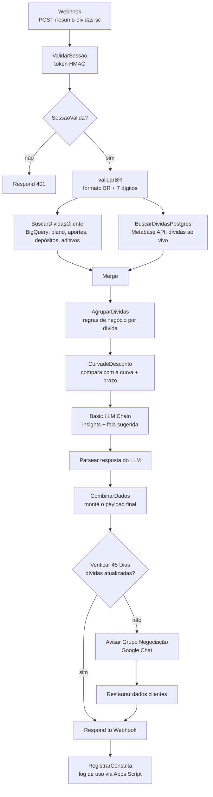

# Copiloto SC: backend em n8n

Este documento descreve o fluxo n8n por trás do **Copiloto SC**, uma ferramenta interna em que o time de Serviço ao Cliente digita o código de um cliente e recebe, em poucos segundos, um raio-x do plano de quitação de dívidas dele: quanto já pagou, em que mês do programa está, o status de cada dívida, se o desconto está dentro da curva esperada e insights gerados por IA com uma sugestão de fala para o atendimento.

O front-end é um único `index.html` (HTML + CSS + JS, sem framework), publicado na Vercel. Ele faz um `POST` para o webhook descrito aqui e só renderiza o que recebe. **Toda a regra de negócio vive no n8n.**

> O export do fluxo está em [`n8n/copiloto-sc.workflow.json`](../n8n/copiloto-sc.workflow.json). Credenciais, URLs internas, chaves e a curva real de desconto foram removidas ou trocadas por exemplos (veja [Como importar](#como-importar)).

---

## Visão geral



O desenho tem três ideias centrais:

1. **Duas fontes em paralelo.** O BigQuery tem o histórico (plano original, aditivos, depósitos). O Postgres, lido via Metabase, tem o estado *ao vivo* de cada dívida. Cada um cobre um ponto fraco do outro.
2. **Contas determinísticas em código, texto livre na IA.** Mês do plano, parcelas, comissão, desconto e prazo são calculados em JavaScript. O LLM recebe os resultados já prontos e só escreve insights e a fala sugerida. Ele nunca faz conta.
3. **Nada que não seja a resposta atrasa a resposta.** O log de uso roda *depois* do `Respond to Webhook`, com `continueOnError`.

---

## Etapas, node a node

### 1. Autenticação: `Webhook` → `ValidarSessao` → `SessaoValida?`

- O front envia `{ br, session_email, session_token }`.
- O token tem o formato `base64(email|expira_em).assinatura_hmac_sha256`. Ele é gerado no fluxo de login (separado) e vale 30 dias.
- `ValidarSessao` recalcula a assinatura com a chave secreta e confere a expiração e se o e-mail do token bate com o e-mail enviado.
- Se falhar, a resposta é **401** com uma mensagem amigável ("Faça login novamente"). O front então volta para a tela de login.

### 2. `validarBR`

Normaliza (trim, maiúsculas) e valida o código do cliente com `^BR\d{7}$`. Com um BR inválido, o fluxo para antes de gastar qualquer consulta.

### 3. Busca de dados (em paralelo)

**`BuscarDividasCliente` (BigQuery)** devolve uma linha por cliente com:

- dados do plano (status, data de início, duração, aporte mensal, poupança acumulada);
- **mês do plano** (ver [Regra do mês do programa](#regra-do-mês-do-programa));
- aditivos aprovados: quantidade, data do último, nova duração, novo aporte e a lista de `new_debts` de todos eles;
- depósitos: quantidade, soma e valor do primeiro;
- snapshot das dívidas do plano de liquidação original;
- se as dívidas foram atualizadas nos últimos 45 dias.

Um cuidado recorrente: o mesmo cliente pode ter mais de um registro (ex.: um `active` e um `deprecated`). Toda subquery que assume uma linha só usa:

```sql
QUALIFY ROW_NUMBER() OVER (
  PARTITION BY bank_reference
  ORDER BY (status = 'deprecated'), updated_at DESC
) = 1
```

**`BuscarDividasPostgres` (HTTP → Metabase API)** executa uma pergunta salva no Metabase, parametrizada pelo BR, e devolve as dívidas com estado atual, valores, tags (`labels`), indicação de acordo quebrado e parcelas de pagamento estruturado. A leitura passa pelo Metabase porque no warehouse esses campos monetários não vêm totalmente preenchidos.

**`Merge`** junta as duas respostas por posição.

### 4. `AgruparDividas`: regras de negócio por dívida

Converte a resposta tabular do Metabase (`cols` + `rows`) em objetos e aplica as regras abaixo.

| Regra | Como funciona |
|---|---|
| **Status da dívida** | Mapeia o `state` cru para `em_aberto`, `estruturada`, `paga`, `liquidada`, `cancelada` ou `desconhecido`. Estados novos, que ainda não existiam, caem em categorias genéricas em vez de sumir da tela. |
| **Mês previsto de quitação** | Cadeia de fallback: **ao vivo** (Postgres) → **snapshot do aditivo** (casado por credor + valor, do mais novo para o mais antigo) → **snapshot do plano original** (casado por `uid`). A origem usada vai junto na resposta. |
| **Pago total do plano** | `payment_to_bank + reduction_commission` do plano de liquidação. Se não houver snapshot, estima `pagamento inicial + economia × 17,5%`, com a comissão travada em 0 quando não há economia. |
| **Pago total atualizado** | Quando o valor negociado mudou: `pagamento atual + max(0, (dívida − pagamento atual) × 17,5%)`. A comissão é recalculada ao vivo porque o campo gravado no banco pode ficar desatualizado. |
| **Desconto atual** | `1 − pago_total / valor_original`, usando o valor atualizado quando ele existe. |
| **Tags** | Faz o parse de `labels` e expõe `acordo_quebrado` (o front mostra um badge vermelho). |
| **Parcelas pagas** | O primeiro depósito é sempre a taxa de ativação e não conta. Cada depósito é dividido pelo aporte vigente; quando o aporte mudou por aditivo, escolhe o valor de aporte que deixa o depósito mais perto de um número inteiro de parcelas, o que cobre pagamentos em dobro e atrasos de ciclo. |
| **Ordenação** | Dívidas em aberto primeiro, canceladas por último. |

### 5. `CurvadeDesconto`: comparação com o esperado

Para cada dívida:

- busca na **curva de desconto** do credor (um array com o desconto esperado em cada mês, do 1 ao 60; credor sem curva própria usa `OUTROS`) o valor esperado no mês atual;
- calcula a diferença em pontos percentuais e classifica: `abaixo_do_esperado` (< −3 p.p.), `dentro_do_esperado` ou `acima_do_esperado` (> +3 p.p.);
- **sobreposição de segurança:** se o pago total atualizado ficou *maior* que o do plano, a dívida é sempre marcada como `abaixo_do_esperado`, não importa o que a curva diga, porque a negociação piorou;
- **prazo:** compara o mês atual com o mês previsto de quitação (`no_prazo` / `atrasado`);
- **dívidas já quitadas** usam o mês em que foram quitadas, e não o mês atual do cliente, que continua avançando;
- **tendência:** marca `subindo` se a curva ainda cresce de forma relevante nos próximos 6 meses.

A busca na curva é feita em código, a partir de uma tabela embutida no node. Assim não há query pesada e o LLM não precisa calcular nada.

### 6. IA: `Basic LLM Chain` → `Parsear resposta do LLM`

O LLM recebe um JSON enxuto (mês, parcelas, aditivo, e status/prazo de cada dívida) e precisa devolver **apenas** este JSON:

```json
{
  "insights": [{ "text": "...", "tipo": "alerta | positivo | normal" }],
  "fala_sugerida_geral": "..."
}
```

Regras do prompt: no máximo 4 insights de uma frase, **nenhum valor em R$ ou porcentagem** (esses números já aparecem na tela e o LLM não deve reescrevê-los) e tom acolhedor na primeira pessoa do plural. Se a resposta não for um JSON válido, o parse falha de forma explícita.

### 7. `CombinarDados`

Monta o payload final: normaliza tipos (`paraNumero`, `paraBooleano`, porque o Metabase às vezes devolve booleano como string), acrescenta os insights e recupera as tags direto do `AgruparDividas`, já que o `CurvadeDesconto` reconstrói as dívidas sem esses campos. O casamento é por `credor|valor_original`.

### 8. Alerta de dados desatualizados: `Verificar 45 Dias`

Se nenhuma dívida do cliente foi atualizada nos últimos 45 dias, o fluxo manda uma mensagem num grupo do Google Chat pedindo a atualização do plano (SLA de 1 dia). Depois disso, `Restaurar dados clientes` recupera o payload para responder normalmente. O operador recebe a resposta nos dois casos.

### 9. `Respond to Webhook` → `RegistrarConsulta`

Depois da resposta, uma única chamada HTTP a um Google Apps Script grava o log da consulta (operador, BR, data) e incrementa o contador de uso do operador com `LockService`.

Antes eram quatro nodes do Google Sheets (append, busca, incremento, update), cerca de 5 chamadas por consulta. Isso estourava a cota de 60 req/min da Sheets API, compartilhada com outros fluxos, e uma falha ali derrubava a resposta. A troca resolveu os dois problemas.

---

## Regra do mês do programa

O "mês do plano" alimenta o card de status, a comparação com a curva, o prazo de quitação e as parcelas esperadas. A regra é:

- **Sem aditivo:** o mês de entrada é o da taxa de ativação e **não conta**. Quem entrou em maio está no mês 1 em junho e no mês 6 em novembro.
- **Com aditivo:** o mês do aceite do aditivo conta como mês 1.
- O resultado fica limitado ao intervalo de 1 a 60.

```sql
LEAST(GREATEST(
  IF(ad.data_aditivo IS NOT NULL,
     DATE_DIFF(CURRENT_DATE(), CAST(ad.data_aditivo AS DATE), MONTH) + 1,
     DATE_DIFF(CURRENT_DATE(), cr.started_at, MONTH)),
1), 60) AS mes_do_plano
```

*Histórico:* a primeira versão somava +1 em todos os casos e mostrava o cliente um mês à frente. O time de operações reportou o problema e ele foi corrigido em três pontos (query, parcelas esperadas e mês de quitação das dívidas pagas), para que todas as telas usem a mesma régua.

---

## Contrato da resposta (resumo)

```jsonc
{
  "br": "BR0000000",
  "nome_cliente": "...",
  "status_berex": "active",
  "mes_do_plano": 6,
  "duracao_programa": 24,
  "divida_total": 0,
  "aporte_mensal": 0,
  "parcelas_esperadas": 6,
  "parcelas_pagas": 6,
  "poupanca_total": 0,
  "teve_aditivo": false,
  "atualizado_ultimos_45_dias": true,
  "dividas": [
    {
      "banco": "...",
      "status_divida": "em_aberto",
      "valor_original": 0,
      "pago_total_padrao": 0,
      "pago_total_atualizacao": null,
      "desconto_atual": 0.106,
      "desconto_projetado": 0.20,
      "diff_pp": -9.4,
      "status": "abaixo_do_esperado",
      "mes_previsto_quitacao": 7,
      "mes_da_divida": 6,
      "prazo_status": "no_prazo",
      "acordo_quebrado": false,
      "labels": [],
      "parcelas_estruturado": null
    }
  ],
  "insights": [{ "text": "...", "tipo": "normal" }]
}
```

Os valores acima são ilustrativos.

---

## Segurança e operação

- Login individual: e-mail corporativo + senha com hash e salt. A sessão é assinada com HMAC e vale 30 dias.
- CORS restrito ao domínio do front.
- Os segredos ficam em variáveis de ambiente ou credenciais do n8n, nunca no código.
- O log de uso é *fire-and-forget*: se falhar, não afeta o operador.

---
